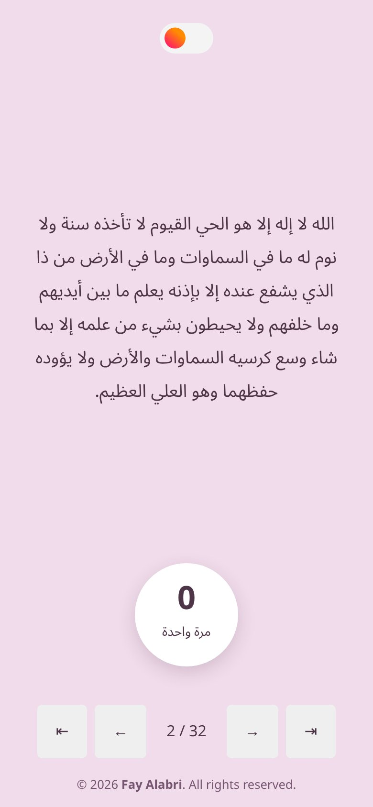
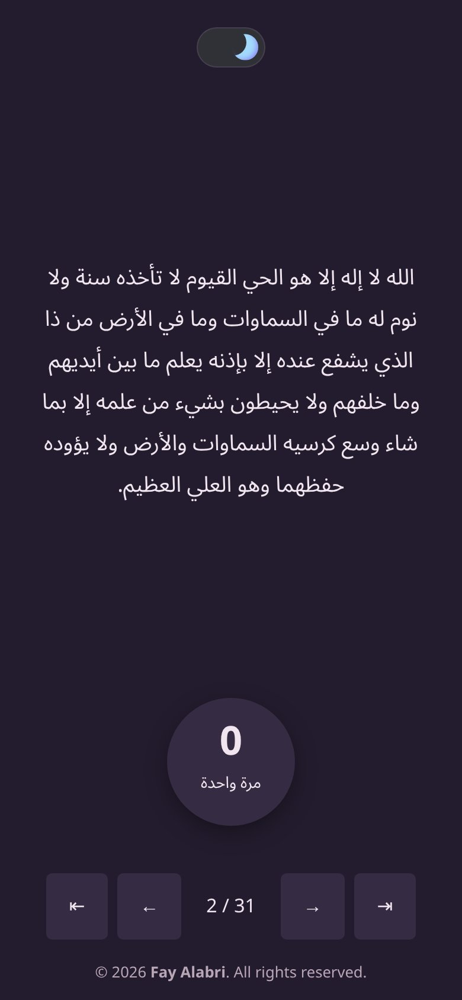
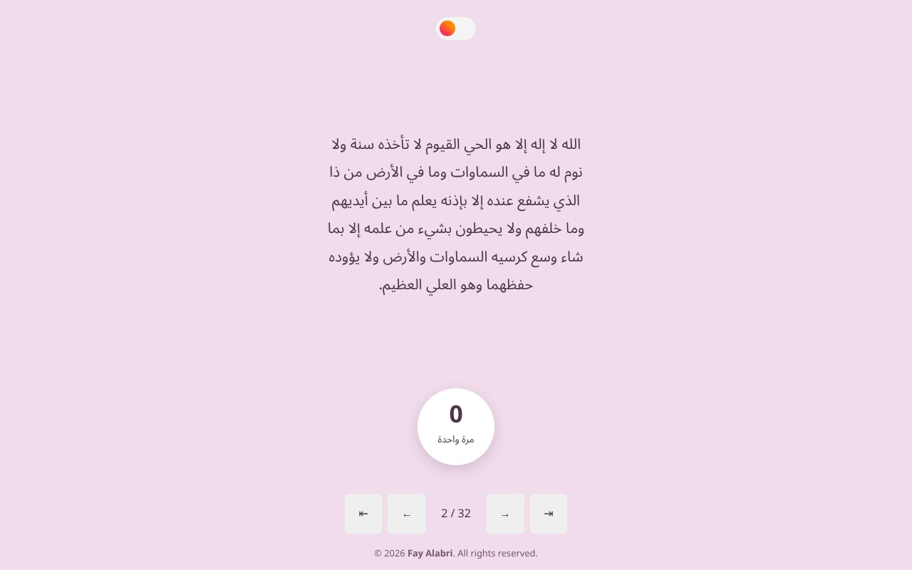

# Athkar 🌙✨

A simple Morning & Evening Adhkar web app — accessible, responsive, and designed for both web and mobile. It offers a peaceful, focused experience to help Muslims stay connected to their daily spiritual routine.

Visit the app here: https://irbala.github.io/Athkar/ 

  
  
  

Click a screenshot to open the live site.

## Features
- Morning & Evening Adhkar (authentic and structured), including their repeating numbers.
- **Tap to count**: tap the round button once for each repetition. When a dhikr is complete it shows a tick and moves on to the next one by itself. "إعادة العد" starts the current dhikr again.
- Clean, minimalist UI
- Responsive on mobile and tablet

## Future Updates
- Font size Adjustments 
- Help Button: guide on how to use the app
- Share Feature
- More Athkar

This project was built with love, sincerity, and the intention to help others reconnect with Allah through the power of remembrance.
May it benefit you and those around you, and may Allah accept our efforts. Ameen. 🌸

## Design Decisions

- **Soft rose for the morning, plum for the evening.** Morning adhkar use a pale rose background with deep plum text. Switching to the evening adhkar swaps the same CSS variables for a dark night palette (`body.evening`), so the app feels calmer after sunset without a second stylesheet.
- **One dhikr at a time.** Each dhikr gets the whole screen, with a large round button to tap for every repetition. When the count is reached it shows a tick and moves on by itself, so you can keep your eyes on the words instead of counting.
- **Right-to-left from the start.** The page is `lang="ar" dir="rtl"`. The "next" arrow points left (←) because that is the reading direction, and every arrow button has an Arabic `aria-label` (التالي, السابق) for screen readers.
- **Numbers stay readable.** The position counter ("2 / 32") is marked `dir="ltr"` and the English footer uses `direction: ltr`, so they don't get reversed inside the Arabic layout.
- **Fonts chosen for reading.** Noto Sans Arabic with a generous line height (1.9) for the adhkar themselves, and Noto Kufi Arabic for the title card.
- **Fits any phone.** The layout uses the full dynamic viewport height (`100dvh`), so the counter and buttons stay on screen and only the dhikr text scrolls. Animations are turned off for people who ask for reduced motion.

## Accessibility

Checked on 19 November 2026 with [axe-core](https://github.com/dequelabs/axe-core) 4.10, the engine behind Lighthouse's accessibility score, against WCAG 2.1 A and AA plus axe's best-practice rules. Every page was tested in a desktop browser.

| Page | Issues | Rules passed |
|---|---|---|
| `index.html` | ✅ 0 issues | 32 |

Both the morning and evening themes were tested, on the title card and on a dhikr with the counter showing.

Fixed in this round:

- The footer text used the pale accent colour (about 2:1 contrast). It now uses a slightly darker soft text colour that passes 4.5:1.
